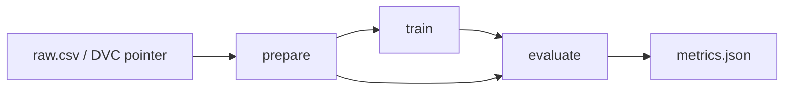

# Домашнее задание №3 · DVC: данные, remote и ML-пайплайн

**Дисциплина:** MLOps Basic, ИТМО, осень 2026.

## Дословное условие из группового чата

«Нужно установить DVC, настроить remote (не обязательно s3) создать пайплайн и данные (советую выбрать что то очень простое и минимальное) и закпоммитить все в гит. Тоесть буквально воспроизвести практическое занятие только на своем рабочем компьютере. Как всегда скинуть ссылку на гит».

## Самостоятельная реализация

Исходный файл `data/raw.csv` содержит 120 синтетических наблюдений, 2 признака и бинарную метку. Для них подготовлен отдельный DAG:



`prepare` делит данные на train/test без утечки, `train` обучает логистическую регрессию, `evaluate` вычисляет accuracy, precision, recall, F1. Код не требует внешних ML-библиотек. `dvc.yaml` описывает стадии и зависимости; `dvc.lock` фиксирует версии входов/выходов. `data/raw.csv.dvc` хранит указатель на исходный CSV, а не сами данные. `.dvc/config` подключён к **локальному** remote `../HW3_DVC_remote`.

Небольшой исходный снимок DVC remote находится в `remote_seed.zip` для переносимости учебного примера. Выполните `python scripts/bootstrap_remote.py` из папки `HW3`: он распакует данные в каталог `HW3_DVC_remote` **за пределами** репозитория (на один уровень выше его корня). Именно туда DVC отправляет объекты через `dvc push`. Сырые данные, модели и результаты из рабочего каталога должны оставаться вне Git. Архив содержит демонстрационный bootstrap, но сам remote нельзя использовать как общую серверную систему хранения.

## Проверка и повторение в Windows PowerShell

Откройте `HW3_Data_Version_Control` как рабочую папку и выполните:

```powershell
uv sync
uv run dvc --version
python scripts/bootstrap_remote.py
uv run dvc pull
uv run dvc status
uv run dvc repro
uv run dvc dag
uv run dvc metrics show
uv run dvc push
uv run dvc status -c
```

Альтернатива: `./scripts/reproduce.ps1`; Linux/macOS: `bash scripts/reproduce.sh`.

Чтобы убедиться в содержательности DAG, измените только `train.learning_rate` в `params.yaml`, повторите `uv run dvc repro` и посмотрите, какие стадии пересчитались. Восстановите исходное значение и снова запустите `repro`. Это демонстрация инкрементальности DVC.

## Публикация ДЗ №3

```sh
git init
git add .
git commit -m "feat(hw3): version synthetic data and ML pipeline with DVC"
git remote add origin https://github.com/YOUR_USERNAME/ITMO-MLOps-HW3.git
git push -u origin main
```

Файлы, которые **обязательно** должны быть в Git: `dvc.yaml`, `dvc.lock`, `.dvc/config`, `.dvcignore`, `data/raw.csv.dvc`, `params.yaml`, Python-код, README и `uv.lock` после реальной генерации `uv sync`. Не добавляйте `.venv`, `.dvc/cache`, сырые данные и большие артефакты. После клонирования с другой машины понадобится доступный remote; локальный remote в ZIP предназначен для демонстрации, а не для коллективной работы через GitHub.

> **Границы проверки:** все исходные файлы и ранее сохранённые md5-метаданные согласованы. Однако официальный DVC CLI здесь недоступен, поэтому успешный `dvc repro`/`dvc push` в текущей среде не подтверждён. Запустите их на своём компьютере и только после этого сдавайте. Команды, документы и lockfile можно проверить через `dvc status`.

Источник: https://dvc.org/doc/start


## Размещение в репозитории курса

Эта работа находится в собственной директории `HW3` репозитория [`MLOps_Orlova_ITMO`](https://github.com/eorlovachem-pixel/MLOps_Orlova_ITMO). Все команды запускаются **из папки `HW3`**, а не из корня репозитория. Блоки с `git init`, `git remote add` и отдельными репозиториями выше сохранены для понимания самостоятельной сдачи, но **не выполняйте их внутри общего репозитория**.


> **Важно для клонированного общего репозитория:** `HW3` является корнем отдельного DVC-проекта внутри Git-репозитория. Локальный remote в `.dvc/config` настроен по относительному пути `../../HW3_DVC_remote`. Это намеренно выводит его из корня Git. После клонирования сначала восстановите демонстрационный remote командой `python scripts/bootstrap_remote.py`, а затем выполните `uv run dvc pull` и `uv run dvc repro`. В основной ветке Git отслеживаются только указатели/метаданные, а не рабочие выходы DVC.
