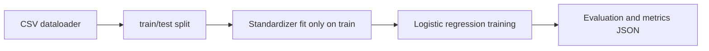

# Домашнее задание №4 · Тестирование ML-пайплайна (unit / integration / E2E)

**Дисциплина:** MLOps Basic, ИТМО, осень 2026.

## Условие из групповой переписки

«Домашка по 3-4 лекции будет следующая: 1. Написать тесты для всего пайплайны (блок, модель, даталоадер, тренировка); 2. Реализовать код (можно навайбкодить); 3. Прогнать тесты; 4. Сделать коммит. Тесты должны включать от себя все — от юнит тестов до e2e, можно по 1-2 теста на каждый из mark».

## Реализация: независимая проверяемая задача

Синтетические данные из `data/raw.csv` (120 строк, 2 числовых признака, бинарная метка) поступают в цепочку:



Весь код написан на стандартной библиотеке Python. Это отличает тестирование поведения модели от зависимости от внешних ML-фреймворков.

## Какие виды тестов реализованы

| Маркер | Проверяет | Как вызвать |
|---|---|---|
| `unit` | даталоадер, split, стандартизацию, сигмоиду, BCE, аналитический градиент, fit, ошибки входных данных | `uv run pytest -m unit -v` |
| `integration` | связь модулей подготовки данных, обучения и оценки | `uv run pytest -m integration -v` |
| `e2e` | запуск `prepare → train → evaluate` через Python CLI в отдельных процессах, детерминированность результата | `uv run pytest -m e2e -v` |

Для теоретического обоснования: unit проверяют маленький контракт, integration — правильность совместной работы, e2e — пользовательский сквозной сценарий. Важно не только «зелёное» число тестов, но и покрытие неуспешных случаев и отсутствие data leakage.

## Воспроизведение

```sh
uv sync
uv run pytest -q
uv run pytest -m unit -v
uv run pytest -m integration -v
uv run pytest -m e2e -v
uv run ruff check .
uv run ruff format --check .
uv run ty check
```

Для запуска ML-пайплайна без pytest:

```sh
uv run python -m mlops_demo.pipeline prepare --input data/raw.csv --output data/processed.json --seed 2026
uv run python -m mlops_demo.pipeline train --input data/processed.json --output models/model.json --epochs 250
uv run python -m mlops_demo.pipeline evaluate --input data/processed.json --model models/model.json --output reports/metrics.json
```

Откройте `reports/metrics.json`, убедитесь, что значения лежат в [0, 1], `n_test` соответствует test split, и что повторный запуск с тем же seed не меняет результат.

## Сдача

```sh
git init
git add .
git commit -m "test(hw4): add unit integration and end-to-end ML pipeline tests"
git remote add origin https://github.com/YOUR_USERNAME/ITMO-MLOps-HW4.git
git push -u origin main
```

Создайте пустой репозиторий GitHub перед push, замените `YOUR_USERNAME`. `uv.lock` следует создать через `uv sync` и включить в коммит. На GitHub продемонстрируйте рабочую проверку Actions.

## Полезная академическая методология

- MIT 6.102, Testing: https://web.mit.edu/6.102/www/sp26/classes/02-testing/
- Stanford CS329S, ML Systems Design: https://bulletin.stanford.edu/courses/2230771

> Проверка в среде подготовки: тесты исполняются установленным pytest. Запуск через `uv`, Ruff и ty требует установки соответствующих CLI и зависимостей.


## Размещение в репозитории курса

Эта работа находится в собственной директории `HW4` репозитория [`MLOps_Orlova_ITMO`](https://github.com/eorlovachem-pixel/MLOps_Orlova_ITMO). Все команды запускаются **из папки `HW4`**, а не из корня репозитория. Блоки с `git init`, `git remote add` и отдельными репозиториями выше сохранены для понимания самостоятельной сдачи, но **не выполняйте их внутри общего репозитория**.
